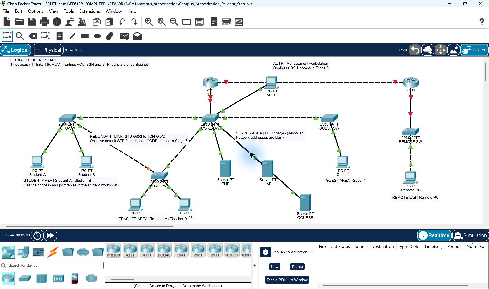
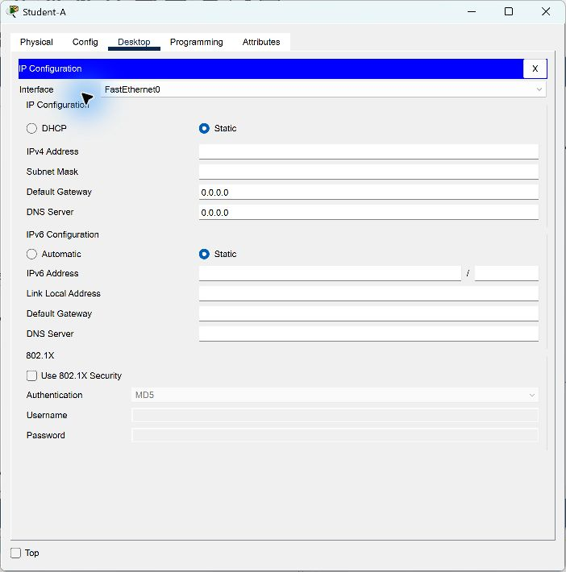

# EE6108 校园网络综合实验：学生任务书

从 `Campus_Authorization_Student_Start.pkt` 开始，用 Cisco Packet Tracer 9.0.1 打开。拓扑已经接好，目标是亲手完成 IP、VLAN、Trunk、路由、ACL、SSH 与 STP，并解释数据包为什么能到达或被拒绝。

这是根据本项目设计的练习，阶段、时长和评分建议属于自拟教学安排；课程正式提交要求以老师发布的 CA 文件为准。

本小组共享副本关闭文件中保存的多用户自动监听、远程保存与点到多点广播选项，并清空 localhost 测试伙伴记录。原有网络实验配置仍为空。在线图片与手册放在同一目录，下载 ZIP 后请一起保留。

## 1. 文件与起点状态

打开后首先另存为 `Campus_Authorization_你的姓名或组名_Working.pkt`。每完成一阶段，另存一份 `Stage1.pkt` 至 `Stage6.pkt`，方便回退。网络设备配置后执行 `copy running-config startup-config`，随后保存 `.pkt`；前者保存设备配置，后者保存整个仿真工程。

| 起点已经提供 | 需要你完成 |
|---|---|
| 两台 2911、五台 2960、七台 PC、三台 Server | 十台终端的 IP、掩码和默认网关 |
| 17 条连线、设备名称、布局、区域提示 | 校园 VLAN 与 Access/Trunk 端口配置 |
| PUB、LAB、COURSE 三个 HTTP 网站的页面 | R1 子接口、R1/R2 地址与静态路由 |
| 交换机默认 VLAN 1、默认 PVST 行为 | 客户端 ACL、SSH 管理与授权/撤销 |
| 所有实验地址、路由、ACL、密钥均未配置 | STP 根桥选择、故障切换与恢复验证 |

路由器接口初始为 `shutdown`，所以接路由器的链路可能是红色；在第三阶段启用。交换机间的冗余三角仍会运行默认 STP，橙色端口可能是正常阻塞。ARP、MAC 地址学习、默认 STP 会自动工作，“没有实验配置”并不意味着所有协议都停止。

三个网站仅预置 HTTP/TCP 80，HTTPS 关闭；其他服务器服务未作为本实验目标。DNS 不必填写，访问网站使用 IP 地址。

## 2. 地址规划

下面是**要配置的目标值**，起点工程中尚未填入。用掩码计算并写出每个子网的网络地址、广播地址、可用范围；不要只抄地址。

| 区域 | VLAN | 子网/前缀 | 掩码 | 网关 |
|---|---:|---|---|---|
| 学生 | 10 | 192.168.10.0/26 | 255.255.255.192 | 192.168.10.1 |
| 教师 | 20 | 192.168.10.64/27 | 255.255.255.224 | 192.168.10.65 |
| 网站 | 30 | 192.168.10.96/28 | 255.255.255.240 | 192.168.10.97 |
| 管理 | 99 | 192.168.10.112/28 | 255.255.255.240 | 192.168.10.113 |
| 访客 | 40 | 192.168.10.128/27 | 255.255.255.224 | 192.168.10.129 |
| R1—R2 | — | 192.168.10.160/30 | 255.255.255.252 | 不适用 |
| 远端 | 1 | 192.168.20.0/27 | 255.255.255.224 | 192.168.20.1 |

| 终端 | IP | 掩码 | 默认网关 |
|---|---|---|---|
| Student-A | 192.168.10.11 | 255.255.255.192 | 192.168.10.1 |
| Student-B | 192.168.10.12 | 255.255.255.192 | 192.168.10.1 |
| Teacher-A | 192.168.10.66 | 255.255.255.224 | 192.168.10.65 |
| Teacher-B | 192.168.10.67 | 255.255.255.224 | 192.168.10.65 |
| PUB | 192.168.10.100 | 255.255.255.240 | 192.168.10.97 |
| LAB | 192.168.10.101 | 255.255.255.240 | 192.168.10.97 |
| COURSE | 192.168.10.102 | 255.255.255.240 | 192.168.10.97 |
| AUTH | 192.168.10.114 | 255.255.255.240 | 192.168.10.113 |
| Guest-1 | 192.168.10.130 | 255.255.255.224 | 192.168.10.129 |
| Remote-PC | 192.168.20.10 | 255.255.255.224 | 192.168.20.1 |

| 网络设备接口 | 目标 IP/前缀 |
|---|---|
| R1 Gi0/0.10、.20、.30、.40、.99 | 依次为各校园 VLAN 的网关地址 |
| R1 Gi0/1 | 192.168.10.161/30 |
| R2 Gi0/0 | 192.168.10.162/30 |
| R2 Gi0/1 | 192.168.20.1/27 |
| CORE-SW Vlan99 | 192.168.10.115/28 |
| STU-SW Vlan99 | 192.168.10.116/28 |
| TCH-SW Vlan99 | 192.168.10.117/28 |
| GUEST-SW Vlan99 | 192.168.10.118/28 |

四台校园交换机的管理默认网关为 `192.168.10.113`；REMOTE-SW 不要求管理 IP。

## 3. 接线与端口任务表

线已接好，不需要重新搭拓扑。Gi 是 GigabitEthernet，Fa 是 FastEthernet；CLI 中可以使用完整名称或 IOS 接受的缩写。

| 端点 A | 端点 B | 第二/三阶段目标 |
|---|---|---|
| R1 Gi0/0 | CORE-SW Fa0/1 | 交换机端为 Trunk；R1 配置 dot1Q 子接口 |
| CORE-SW Gi0/1 | STU-SW Gi0/1 | 两端 Trunk |
| CORE-SW Gi0/2 | TCH-SW Gi0/1 | 两端 Trunk |
| STU-SW Gi0/2 | TCH-SW Gi0/2 | 两端 Trunk，冗余路径 |
| CORE-SW Fa0/5 | GUEST-SW Gi0/1 | 两端 Trunk |
| STU-SW Fa0/1 | Student-A Fa0 | Access VLAN 10 |
| STU-SW Fa0/2 | Student-B Fa0 | Access VLAN 10 |
| TCH-SW Fa0/1 | Teacher-A Fa0 | Access VLAN 20 |
| TCH-SW Fa0/2 | Teacher-B Fa0 | Access VLAN 20 |
| CORE-SW Fa0/2 | PUB Fa0 | Access VLAN 30 |
| CORE-SW Fa0/3 | LAB Fa0 | Access VLAN 30 |
| CORE-SW Fa0/6 | COURSE Fa0 | Access VLAN 30 |
| CORE-SW Fa0/4 | AUTH Fa0 | Access VLAN 99 |
| GUEST-SW Fa0/1 | Guest-1 Fa0 | Access VLAN 40 |
| R1 Gi0/1 | R2 Gi0/0 | 三层 /30 链路 |
| R2 Gi0/1 | REMOTE-SW Gi0/1 | 普通远端 LAN，VLAN 1 |
| REMOTE-SW Fa0/1 | Remote-PC Fa0 | Access VLAN 1 |

校园 Trunk 允许 VLAN `10,20,30,40,99`，两端保持一致。四台校园交换机创建这五个 VLAN，分别命名 STUDENT、TEACHER、SERVER、GUEST、MGMT。保留默认 native VLAN 1，本实验不把业务 VLAN 配成 native VLAN。

## 4. 操作入口与命令模式

- PC/Server 地址：点击设备 → Desktop → IP Configuration → Static，填写 IP、掩码、网关。
- PC 验证：Desktop → Command Prompt，使用 `ipconfig`、`ping`、`arp -a`。这是 Packet Tracer 内的模拟终端。
- 网页：Desktop → Web Browser，输入 `http://192.168.10.100` 等地址，点击 **Go** 发起新请求。
- 网络设备：点击设备 → CLI。提示符 `>` 表示用户模式，`#` 表示特权模式，`(config)#` 表示全局配置，`(config-if)#` 表示接口配置。

最小的模式导航示例：

```text
enable
configure terminal
! 在这里输入本阶段的配置
end
show running-config
copy running-config startup-config
```

代码中的 `!` 行是说明。进入命名 ACL 后，用 `exit` 返回全局配置再创建下一张 ACL，避免把全局命令输在错误模式。遇到错误先看提示符、接口名和上一条命令，不要连续粘贴尚未理解的答案。

## 5. 六阶段任务

### 第一阶段：IP、ARP 与二层交换（建议 25 分钟）

**任务**：先配置 Student-A、Student-B 的 IP、掩码、网关；其他终端可在本阶段一起填完。暂不设置 VLAN、路由或 ACL。等待默认 STP 稳定，然后从 A ping B。

```text
ipconfig
ping 192.168.10.12
arp -a
```

在 STU-SW 的特权模式观察：

```text
show mac address-table
show vlan brief
```

**预期**：A 与 B 在默认 VLAN 1 中互通；由于 R1 尚未配置，A ping 网关不会成功。首次测试可能等待 ARP 或 STP，稳定后再次测试并记录。此时看到 VLAN 1 是起点行为，第二阶段才改为 VLAN 10。

**Simulation 观察**：切换 Simulation，仅保留 ARP、ICMP 过滤，从 A ping B，使用 Capture/Forward 查看事件。记录 ARP Request 的广播目的 MAC、ARP Reply 的单播地址；区分 ARP 包与其外层以太网帧。完成后返回 Realtime。

**提交**：A→B 的 ping 和 ARP 表、STU-SW 的 MAC 表各一张截图。回答：同网段通信是否必须经过路由器？A 用掩码判断什么，交换机用什么表决定出端口？

### 第二阶段：VLAN、Access 与 Trunk（建议 35 分钟）

**任务**：按照端口表创建 VLAN、配置终端 Access 端口以及五条校园 Trunk。远端交换机仍使用 VLAN 1。四台校园交换机配置 Vlan99 管理地址，但此时暂不要求跨网段管理。

```text
show vlan brief
show interfaces trunk
show interfaces switchport
show ip interface brief
```

**预期**：学生 A/B 同 VLAN 通信，教师 A/B 同 VLAN 通信；学生→教师仍失败。业务端口不应全部留在 VLAN 1。VLAN 存在和 Trunk 允许列表是两个不同检查项。冗余 Trunk 某端口被 STP 阻塞可正常存在，不要为了“全部变绿”关闭 STP。

**提交**：校园 VLAN 表、Trunk 表、两组同 VLAN 成功及跨 VLAN 失败结果。回答：Access 帧与 Trunk 帧有什么区别？为什么只创建 VLAN 不足以让它经过所有 Trunk？

### 第三阶段：跨 VLAN 路由与远端网络（建议 35 分钟）

**任务**：启用 R1 Gi0/0，创建五个 dot1Q 子接口并配置各 VLAN 网关；启用 R1 Gi0/1、R2 Gi0/0、R2 Gi0/1 并配置地址。配置双向静态路由：R1 的远端 `/27` 路由经 `192.168.10.162`；R2 的校园 `192.168.10.0/24` 汇总路由经 `192.168.10.161`。校园交换机配置管理默认网关。

先只完成连通性，**尚不绑定 ACL**。

```text
show ip interface brief
show ip route
show running-config
```

**预期**：每台终端可 ping 自己的网关，Student-A→Teacher-A、Student-A→Remote-PC、Guest-1→Remote-PC 都成功。Student-A 浏览三个 HTTP 网站都成功；这是第四阶段施加限制前的对照基线。

**观察**：A→B 时 ARP 找 B；A→Remote-PC 时 ARP 找网关。路由器转发时目的 IP 通常保持为 Remote-PC，链路上的源/目的 MAC 随下一跳变化。

**提交**：R1/R2 路由表、A 的网关与远端 ping、三网站新请求结果。回答：回程路由为什么不可缺少？交换机按 MAC 转发与路由器按 IP 路由分别发生在哪一层？

### 第四阶段：ACL 默认访问策略（建议 35 分钟）

**任务**：在 R1 创建 STUDENT_POLICY、TEACHER_POLICY、GUEST_POLICY 三张扩展 ACL，分别绑定到 `.10`、`.20`、`.40` 子接口的 **in** 方向。按下表实现默认策略；允许各组 ping 自己的网关，最后显式 `deny ip any any`。允许规则必须位于最终拒绝前。

| 来源 | PUB HTTP | LAB HTTP | COURSE HTTP | Ping 自己网关 | Ping Remote-PC |
|---|---|---|---|---|---|
| Student-A、Student-B | 允许 | 拒绝 | 拒绝 | 允许 | 允许 |
| Teacher-A、Teacher-B | 允许 | 允许 | 允许 | 允许 | 允许 |
| Guest-1 | 允许 | 拒绝 | 拒绝 | 允许 | 拒绝 |

除这些允许项外，三组发起的其他三层访问被拒绝，包括到管理网段的访问。AUTH/服务器所在的 VLAN 99/30 在此项目中不绑定上述客户端入口 ACL。

```text
show access-lists
show ip interface GigabitEthernet0/0.10
show ip interface GigabitEthernet0/0.20
show ip interface GigabitEthernet0/0.40
```

**预期**：Student-A→Teacher-A 由第三阶段的成功变为失败；A→B 仍成功，因为其帧在同 VLAN 内交换，未经过 R1 入口 ACL。网页必须点 Go 测新请求，不把旧页面当成新访问成功。

**提交**：完整填写上述矩阵，附至少一组允许/拒绝截图、ACL 定义与实际绑定。回答：为什么 `permit ip any any` 会破坏策略？为什么 ping 失败不能直接证明 HTTP 也被拒绝？

### 第五阶段：SSH 管理与按来源授权（建议 35 分钟）

**任务**：在 R1 配置实验域名、`labteacher` 本地管理账号、SSH v2 和 RSA 密钥，RSA 使用本工程教师版已验证的 1024 位规格。仅为这个仿真实验设置口令；起点中没有账号或密钥。VTY 使用 `login local`、只允许 SSH，并用 MGMT_ONLY 标准 ACL 仅允许来源 `192.168.10.114`。

在 AUTH → Desktop → Telnet / SSH Client 中选择 SSH，连接 `192.168.10.113`。用 AUTH 的 SSH 会话完成下面的授权，不只在 R1 本地 CLI 改配置。

1. 创建并启用独立的学生授权 ACL：保留学生默认许可，再增加 **仅 Student-A** 到 LAB、COURSE 的 HTTP 许可。
2. 验证 A 的两站成功、B 的两站仍失败，A/B 的 PUB 与远端 ping 许可仍保留。
3. 撤销 A 的 COURSE 权限，但保留 LAB；重新点击 Go 验证两站不同结果。
4. 给 Guest-1 单独开放 LAB，验证 COURSE 仍被拒绝且远端 ping 仍被拒绝。
5. 在 Remote-PC 尝试连接同一个 R1 SSH 地址，验证非 AUTH 来源被拒绝。
6. 恢复第四阶段默认学生/访客 ACL 并保存；恢复结果也要验证。

可以通过“完整命名 ACL 方案切换”实现授权，避免在最后的 deny 后追加 permit。教师完成版采用这种方案；学生需要自己写出许可条目和正确绑定。

```text
show ip ssh
show access-lists
show running-config
```

**提交**：AUTH 登录成功、非 AUTH 被拒、A 授权/B 未授权、撤销后 LAB 成功/COURSE 失败、访客独立授权和恢复默认的截图与实际配置。

**回答**：这里的授权匹配什么身份？它按源 IP 匹配，是否等同于网站账号登录？SSH 保护哪段通信，是否让 HTTP 内容也变成加密传输？

### 第六阶段：STP、备用链路与恢复（建议 30 分钟）

**任务**：先记录默认根桥；再对 VLAN `10,20,30,40,99` 设置 CORE-SW 优先级 4096、STU-SW 8192、TCH-SW 12288。保留 STP。正常状态检查 VLAN 10；随后关闭 STU-SW Gi0/1，等待收敛，再测试 Student-A→Remote-PC 和 PUB；最后恢复 Gi0/1 并复测。

```text
show spanning-tree vlan 10
show interfaces trunk
```

在 Student-A 的模拟 Command Prompt 中：

```text
ping 192.168.20.10
```

| 状态 | 需要观察的结果 |
|---|---|
| 正常 | CORE 为根；STU Gi0/1 Root/FWD；TCH Gi0/2 Alternate/Blocking |
| STU Gi0/1 关闭后收敛 | STU Gi0/2 成为 Root/FWD，经 TCH 到 CORE；远端通信恢复 |
| Gi0/1 恢复后收敛 | STU Gi0/1 恢复 Root/FWD；TCH Gi0/2 再次阻塞 |

初期收敛可能丢包，记录等待和丢包情况；成功表示**收敛后可通信**，不据此声称零中断。单次 Simple PDU 的失败不足以单独下结论，结合端口状态和真实 ping 检查。

**提交**：三种 STP 状态、主链路关闭期间 ping、恢复后 ping 和网页新请求截图。回答：为什么不能让三角中所有端口一直转发？这个备份能否解决 R1 或 CORE-SW 整机故障？

## 6. 实验记录模板

每关至少填写一行；保留发生过的错误、原因与修复，不要只展示最终成功。

| 阶段/测试 | 操作或配置 | 预期 | 实际观察 | 截图文件名 | 原因解释/修复 |
|---|---|---|---|---|---|
| 1：A→B | 待填写 | 成功 | 待填写 | 待填写 | 待填写 |
| 2：A→教师 | 待填写 | 失败 | 待填写 | 待填写 | 待填写 |
| 3：A→Remote | 待填写 | 成功 | 待填写 | 待填写 | 待填写 |
| 4：默认三组权限矩阵 | 待填写 | 符合矩阵 | 待填写 | 待填写 | 待填写 |
| 5：授权/撤销/恢复 | 待填写 | A/B/Guest 独立 | 待填写 | 待填写 | 待填写 |
| 6：主链路故障与恢复 | 待填写 | 收敛后恢复通信 | 待填写 | 待填写 | 待填写 |

截图插在解释后面，例如：

```markdown
Student-A 与 B 属于同一子网，A 通过 ARP 得到 B 的 MAC，帧由 STU-SW 直接交换。


```

小组可以分别负责地址/VLAN、路由/ACL、管理/STP、验证/报告；实际按人数合并角色。最终每个人都应能解释从 A 到 Remote-PC 的完整路径，并能独立完成一次授权或故障恢复。

## 7. 交付与自查

- 一份自己的 `Working.pkt` 或 `Stage6.pkt`，以及关键阶段存档。
- 一份 Markdown 报告，包含六阶段记录、填好的默认与授权访问矩阵、必要配置、内嵌截图及思考题回答。
- 展示时先恢复默认 ACL 和正常主链路，再演示授权/撤销与主链路失效，最后恢复并保存。
- 不把教师完成版改名作为学生实验结果。教师文件和完整答案文档由组织者另行保管。

建议自评：IP/ARP 15 分、VLAN/Trunk 20 分、路由 20 分、ACL 20 分、SSH/授权 15 分、STP/故障记录 10 分。这不是老师公布的 CA 评分标准。

## 8. 起点检查图片

以下图片属于起点工程验收证据，不是六阶段完成答案。学生完成阶段后，应在自己的报告中放入自己的截图。



IP 配置窗口中地址和掩码为空，网关 0.0.0.0 表示尚未填写。


测试副本填写 A/B 地址并验证后，重新打开交付起点，地址仍为空。


