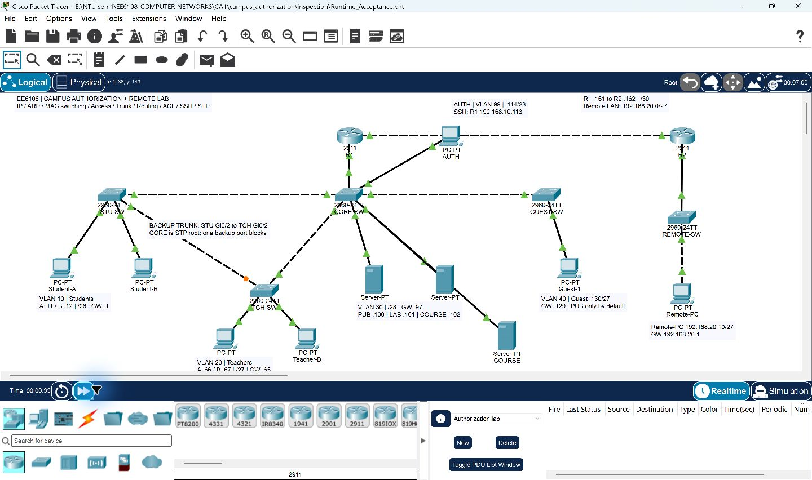
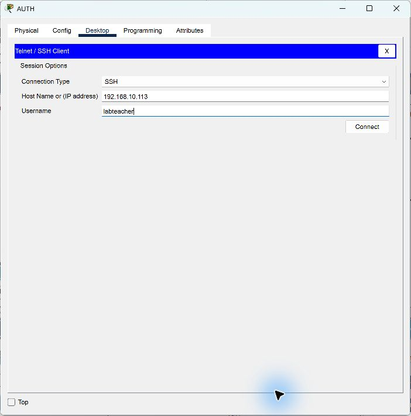
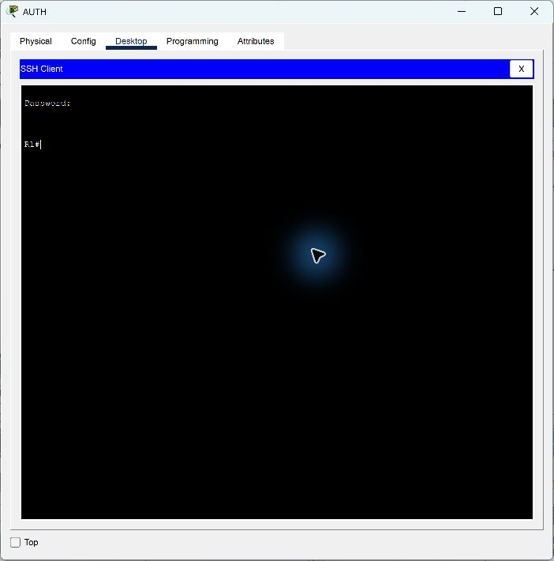

# 校园授权教师完成版：演示专用

这是与学生起点对应的已配置参考工程，使用 Cisco Packet Tracer 9.0.1。保留了完整网络配置、R1 的仿真 SSH RSA 密钥和实验账号，便于下载后直接演示。学生起点仍用于独立动手配置；教师包包含参考答案。

## 下载与凭据

- [教师完成版 .pkt](Campus_Authorization_Master.pkt)
- [教师演示包 ZIP](Campus_Authorization_Teacher_Demo.zip)：工程、本说明、三张真实截图与校验文件。
- SSH：从 AUTH 连接 `192.168.10.113`，用户名 `labteacher`，密码 `Campus6108!`。
- 这些口令和工程内密钥是教学仿真凭据，按用户要求随示范文件分发，应视为共享且已公开给下载者。不要复用到真实账号或真实设备。
- 保存的多用户自动监听、远程保存及点到多点广播选项为 `false`，localhost 伙伴记录已清空；网络设备配置和全部 SSH 密钥与本地主工程一致。



## 初始状态与演示顺序

拓扑共 17 台设备、17 条连线。R1 是校园五个 VLAN 的网关，R2 连接远端实验室；CORE-SW 是 STP 根桥，STU-SW/TCH-SW 间有备用 Trunk。本工程使用 PVST，没有双核心、HSRP 或服务器热备。

| 来源 | PUB .100 | COURSE .102 | LAB .101 | Ping 远端 .20.10 | SSH 管理 R1 |
|---|---|---|---|---|---|
| Student-A / B | 允许 | 拒绝 | 拒绝 | 允许 | 拒绝 |
| Teacher-A / B | 允许 | 允许 | 允许 | 允许 | 拒绝 |
| Guest-1 | 允许 | 拒绝 | 拒绝 | 拒绝 | 拒绝 |
| AUTH | 允许 | 允许 | 允许 | 允许 | 允许 |

网站地址均为 `192.168.10.*`，协议为 HTTP/TCP 80；远端 PC 为 `192.168.20.10`。Ping 网站不是 HTTP 权限测试。

1. 打开教师 .pkt，另存为自己的 `Teacher_Working.pkt`，等待链路与 STP 收敛。
2. 在 Student-A 浏览器访问 `http://192.168.10.100`、`.102`、`.101`，每次点击 Go 发起新请求；先观察公共网站成功、另两站受限。
3. 在 AUTH 的 Desktop → Telnet / SSH Client 选择 SSH，使用上面的实验账号登录。
4. 执行下面的权限切换命令，回到 Student-A 点击 Go；同时检查 Student-B 仍受限。
5. 用 STU-SW 主上联故障观察备用路径接管；完成后恢复上联和默认 ACL。





## 授权、撤销与恢复代码

这些命令输入到 Packet Tracer 的模拟设备。主工程已定义全部 16 种学生组合和 4 种访客组合；四个学生位从左到右代表 B LAB、B COURSE、A LAB、A COURSE。

给 A 同时开通 LAB 和 COURSE：

```text
configure terminal
interface GigabitEthernet0/0.10
ip access-group STUDENT_G0011 in
end
```

只撤销 A 的 COURSE，保留 LAB：

```text
configure terminal
interface GigabitEthernet0/0.10
ip access-group STUDENT_G0010 in
end
```

给 Guest-1 单独开通 LAB（COURSE 保持受限）：

```text
configure terminal
interface GigabitEthernet0/0.40
ip access-group GUEST_G10 in
end
```

查看当前策略与 SSH：

```text
show ip interface GigabitEthernet0/0.10
show access-lists STUDENT_G0010
show access-lists MGMT_ONLY
show ip ssh
```

在 STU-SW 关闭主上联，等待备用 Trunk 收敛后测试授权网站与远端 Ping：

```text
enable
show spanning-tree vlan 10
configure terminal
interface GigabitEthernet0/1
shutdown
end
show spanning-tree vlan 10
```

恢复 STU-SW 主上联：

```text
configure terminal
interface GigabitEthernet0/1
no shutdown
end
write memory
```

在 R1 恢复默认 ACL，再保存 Packet Tracer 文件：

```text
configure terminal
interface GigabitEthernet0/0.10
ip access-group STUDENT_POLICY in
interface GigabitEthernet0/0.40
ip access-group GUEST_POLICY in
end
write memory
```

## 核对范围和公开说明

原教师完成版于 2026-10-09 保存了核心运行验收记录，包括默认权限、关键授权与撤销、SSH 重开登录、ARP/MAC、静态路由和 STP 备用链路。20 种权限组合的定义做过静态核对，运行测试覆盖关键场景，并未穷举每个来源、协议与组合。

2026-10-11 共享副本重新核对了编码往返、17 台设备/17 条连线、默认 ACL、SSH 密钥保留和所有设备数据完全一致。仅修改软件多用户连接保存选项。本次上传没有重新运行全部网络实验，三张图片为原真实操作记录。

本教师版包含答案及可下载的演示凭据。仓库将来转成公开后，任何人都能取得这些材料及其历史版本；正在评分的 CA 是否允许公开完整答案，仍以课程要求为准。真实个人密码、个人 SSH/API 密钥和课程原始材料不在本包内。

## 七台设备的完整保存配置

下面从教师 .pkt 的 RUNNINGCONFIG 直接提取，含实验账号的保存形式，便于比对。SSH 的二进制密钥数据保留在 .pkt 内；单独粘贴文本配置不能恢复同一份已生成密钥。重建空白路由器时仍需生成自己的仿真 RSA 密钥。

### R1

```text
!
version 15.1
no service timestamps log datetime msec
no service timestamps debug datetime msec
no service password-encryption
!
hostname R1
!
!
!
!
!
!
!
!
ip cef
no ipv6 cef
!
!
!
username labteacher privilege 15 secret 5 $1$mERr$cqltlZm9VqF.P7gbUlwBv.
!
!
license udi pid CISCO2911/K9 sn EE6108LAB001
!
!
!
!
!
!
!
!
!
!
!
ip ssh version 2
ip ssh time-out 60
ip domain-name campus.local
!
!
spanning-tree mode pvst
!
!
!
!
!
!
interface GigabitEthernet0/0
 no ip address
 duplex auto
 speed auto
!
interface GigabitEthernet0/0.10
 encapsulation dot1Q 10
 ip address 192.168.10.1 255.255.255.192
 ip access-group STUDENT_POLICY in
!
interface GigabitEthernet0/0.20
 encapsulation dot1Q 20
 ip address 192.168.10.65 255.255.255.224
 ip access-group TEACHER_POLICY in
!
interface GigabitEthernet0/0.30
 encapsulation dot1Q 30
 ip address 192.168.10.97 255.255.255.240
!
interface GigabitEthernet0/0.40
 encapsulation dot1Q 40
 ip address 192.168.10.129 255.255.255.224
 ip access-group GUEST_POLICY in
!
interface GigabitEthernet0/0.99
 encapsulation dot1Q 99
 ip address 192.168.10.113 255.255.255.240
!
interface GigabitEthernet0/1
 ip address 192.168.10.161 255.255.255.252
 duplex auto
 speed auto
!
interface GigabitEthernet0/2
 no ip address
 duplex auto
 speed auto
 shutdown
!
interface Vlan1
 no ip address
 shutdown
!
ip classless
ip route 192.168.20.0 255.255.255.224 192.168.10.162 
!
ip flow-export version 9
!
!
ip access-list standard MGMT_ONLY
 permit host 192.168.10.114
 deny any
ip access-list extended STUDENT_POLICY
 permit tcp 192.168.10.0 0.0.0.63 host 192.168.10.100 eq www
 permit icmp 192.168.10.0 0.0.0.63 host 192.168.10.1 echo
 permit icmp 192.168.10.0 0.0.0.63 host 192.168.20.10 echo
 deny ip any 192.168.10.112 0.0.0.15
 deny ip any any
ip access-list extended GUEST_POLICY
 permit tcp 192.168.10.128 0.0.0.31 host 192.168.10.100 eq www
 permit icmp 192.168.10.128 0.0.0.31 host 192.168.10.129 echo
 deny ip any 192.168.10.112 0.0.0.15
 deny ip any any
ip access-list extended TEACHER_POLICY
 permit tcp 192.168.10.64 0.0.0.31 host 192.168.10.100 eq www
 permit tcp 192.168.10.64 0.0.0.31 host 192.168.10.101 eq www
 permit tcp 192.168.10.64 0.0.0.31 host 192.168.10.102 eq www
 permit icmp 192.168.10.64 0.0.0.31 host 192.168.10.65 echo
 permit icmp 192.168.10.64 0.0.0.31 host 192.168.20.10 echo
 deny ip any 192.168.10.112 0.0.0.15
 deny ip any any
ip access-list extended STUDENT_G0001
 permit tcp 192.168.10.0 0.0.0.63 host 192.168.10.100 eq www
 permit icmp 192.168.10.0 0.0.0.63 host 192.168.10.1 echo
 permit tcp host 192.168.10.11 host 192.168.10.102 eq www
 permit icmp 192.168.10.0 0.0.0.63 host 192.168.20.10 echo
 deny ip any 192.168.10.112 0.0.0.15
 deny ip any any
ip access-list extended STUDENT_G0010
 permit tcp 192.168.10.0 0.0.0.63 host 192.168.10.100 eq www
 permit icmp 192.168.10.0 0.0.0.63 host 192.168.10.1 echo
 permit tcp host 192.168.10.11 host 192.168.10.101 eq www
 permit icmp 192.168.10.0 0.0.0.63 host 192.168.20.10 echo
 deny ip any 192.168.10.112 0.0.0.15
 deny ip any any
ip access-list extended STUDENT_G0011
 permit tcp 192.168.10.0 0.0.0.63 host 192.168.10.100 eq www
 permit icmp 192.168.10.0 0.0.0.63 host 192.168.10.1 echo
 permit tcp host 192.168.10.11 host 192.168.10.102 eq www
 permit tcp host 192.168.10.11 host 192.168.10.101 eq www
 permit icmp 192.168.10.0 0.0.0.63 host 192.168.20.10 echo
 deny ip any 192.168.10.112 0.0.0.15
 deny ip any any
ip access-list extended STUDENT_G0100
 permit tcp 192.168.10.0 0.0.0.63 host 192.168.10.100 eq www
 permit icmp 192.168.10.0 0.0.0.63 host 192.168.10.1 echo
 permit tcp host 192.168.10.12 host 192.168.10.102 eq www
 permit icmp 192.168.10.0 0.0.0.63 host 192.168.20.10 echo
 deny ip any 192.168.10.112 0.0.0.15
 deny ip any any
ip access-list extended STUDENT_G0101
 permit tcp 192.168.10.0 0.0.0.63 host 192.168.10.100 eq www
 permit icmp 192.168.10.0 0.0.0.63 host 192.168.10.1 echo
 permit tcp host 192.168.10.11 host 192.168.10.102 eq www
 permit tcp host 192.168.10.12 host 192.168.10.102 eq www
 permit icmp 192.168.10.0 0.0.0.63 host 192.168.20.10 echo
 deny ip any 192.168.10.112 0.0.0.15
 deny ip any any
ip access-list extended STUDENT_G0110
 permit tcp 192.168.10.0 0.0.0.63 host 192.168.10.100 eq www
 permit icmp 192.168.10.0 0.0.0.63 host 192.168.10.1 echo
 permit tcp host 192.168.10.11 host 192.168.10.101 eq www
 permit tcp host 192.168.10.12 host 192.168.10.102 eq www
 permit icmp 192.168.10.0 0.0.0.63 host 192.168.20.10 echo
 deny ip any 192.168.10.112 0.0.0.15
 deny ip any any
ip access-list extended STUDENT_G0111
 permit tcp 192.168.10.0 0.0.0.63 host 192.168.10.100 eq www
 permit icmp 192.168.10.0 0.0.0.63 host 192.168.10.1 echo
 permit tcp host 192.168.10.11 host 192.168.10.102 eq www
 permit tcp host 192.168.10.11 host 192.168.10.101 eq www
 permit tcp host 192.168.10.12 host 192.168.10.102 eq www
 permit icmp 192.168.10.0 0.0.0.63 host 192.168.20.10 echo
 deny ip any 192.168.10.112 0.0.0.15
 deny ip any any
ip access-list extended STUDENT_G1000
 permit tcp 192.168.10.0 0.0.0.63 host 192.168.10.100 eq www
 permit icmp 192.168.10.0 0.0.0.63 host 192.168.10.1 echo
 permit tcp host 192.168.10.12 host 192.168.10.101 eq www
 permit icmp 192.168.10.0 0.0.0.63 host 192.168.20.10 echo
 deny ip any 192.168.10.112 0.0.0.15
 deny ip any any
ip access-list extended STUDENT_G1001
 permit tcp 192.168.10.0 0.0.0.63 host 192.168.10.100 eq www
 permit icmp 192.168.10.0 0.0.0.63 host 192.168.10.1 echo
 permit tcp host 192.168.10.11 host 192.168.10.102 eq www
 permit tcp host 192.168.10.12 host 192.168.10.101 eq www
 permit icmp 192.168.10.0 0.0.0.63 host 192.168.20.10 echo
 deny ip any 192.168.10.112 0.0.0.15
 deny ip any any
ip access-list extended STUDENT_G1010
 permit tcp 192.168.10.0 0.0.0.63 host 192.168.10.100 eq www
 permit icmp 192.168.10.0 0.0.0.63 host 192.168.10.1 echo
 permit tcp host 192.168.10.11 host 192.168.10.101 eq www
 permit tcp host 192.168.10.12 host 192.168.10.101 eq www
 permit icmp 192.168.10.0 0.0.0.63 host 192.168.20.10 echo
 deny ip any 192.168.10.112 0.0.0.15
 deny ip any any
ip access-list extended STUDENT_G1011
 permit tcp 192.168.10.0 0.0.0.63 host 192.168.10.100 eq www
 permit icmp 192.168.10.0 0.0.0.63 host 192.168.10.1 echo
 permit tcp host 192.168.10.11 host 192.168.10.102 eq www
 permit tcp host 192.168.10.11 host 192.168.10.101 eq www
 permit tcp host 192.168.10.12 host 192.168.10.101 eq www
 permit icmp 192.168.10.0 0.0.0.63 host 192.168.20.10 echo
 deny ip any 192.168.10.112 0.0.0.15
 deny ip any any
ip access-list extended STUDENT_G1100
 permit tcp 192.168.10.0 0.0.0.63 host 192.168.10.100 eq www
 permit icmp 192.168.10.0 0.0.0.63 host 192.168.10.1 echo
 permit tcp host 192.168.10.12 host 192.168.10.102 eq www
 permit tcp host 192.168.10.12 host 192.168.10.101 eq www
 permit icmp 192.168.10.0 0.0.0.63 host 192.168.20.10 echo
 deny ip any 192.168.10.112 0.0.0.15
 deny ip any any
ip access-list extended STUDENT_G1101
 permit tcp 192.168.10.0 0.0.0.63 host 192.168.10.100 eq www
 permit icmp 192.168.10.0 0.0.0.63 host 192.168.10.1 echo
 permit tcp host 192.168.10.11 host 192.168.10.102 eq www
 permit tcp host 192.168.10.12 host 192.168.10.102 eq www
 permit tcp host 192.168.10.12 host 192.168.10.101 eq www
 permit icmp 192.168.10.0 0.0.0.63 host 192.168.20.10 echo
 deny ip any 192.168.10.112 0.0.0.15
 deny ip any any
ip access-list extended STUDENT_G1110
 permit tcp 192.168.10.0 0.0.0.63 host 192.168.10.100 eq www
 permit icmp 192.168.10.0 0.0.0.63 host 192.168.10.1 echo
 permit tcp host 192.168.10.11 host 192.168.10.101 eq www
 permit tcp host 192.168.10.12 host 192.168.10.102 eq www
 permit tcp host 192.168.10.12 host 192.168.10.101 eq www
 permit icmp 192.168.10.0 0.0.0.63 host 192.168.20.10 echo
 deny ip any 192.168.10.112 0.0.0.15
 deny ip any any
ip access-list extended STUDENT_G1111
 permit tcp 192.168.10.0 0.0.0.63 host 192.168.10.100 eq www
 permit icmp 192.168.10.0 0.0.0.63 host 192.168.10.1 echo
 permit tcp host 192.168.10.11 host 192.168.10.102 eq www
 permit tcp host 192.168.10.11 host 192.168.10.101 eq www
 permit tcp host 192.168.10.12 host 192.168.10.102 eq www
 permit tcp host 192.168.10.12 host 192.168.10.101 eq www
 permit icmp 192.168.10.0 0.0.0.63 host 192.168.20.10 echo
 deny ip any 192.168.10.112 0.0.0.15
 deny ip any any
ip access-list extended GUEST_G01
 permit tcp 192.168.10.128 0.0.0.31 host 192.168.10.100 eq www
 permit icmp 192.168.10.128 0.0.0.31 host 192.168.10.129 echo
 permit tcp host 192.168.10.130 host 192.168.10.102 eq www
 deny ip any 192.168.10.112 0.0.0.15
 deny ip any any
ip access-list extended GUEST_G10
 permit tcp 192.168.10.128 0.0.0.31 host 192.168.10.100 eq www
 permit icmp 192.168.10.128 0.0.0.31 host 192.168.10.129 echo
 permit tcp host 192.168.10.130 host 192.168.10.101 eq www
 deny ip any 192.168.10.112 0.0.0.15
 deny ip any any
ip access-list extended GUEST_G11
 permit tcp 192.168.10.128 0.0.0.31 host 192.168.10.100 eq www
 permit icmp 192.168.10.128 0.0.0.31 host 192.168.10.129 echo
 permit tcp host 192.168.10.130 host 192.168.10.102 eq www
 permit tcp host 192.168.10.130 host 192.168.10.101 eq www
 deny ip any 192.168.10.112 0.0.0.15
 deny ip any any
!
!
!
!
!
line con 0
 logging synchronous
!
line aux 0
!
line vty 0 4
 access-class MGMT_ONLY in
 login local
 transport input ssh
!
!
!
end
```

### R2

```text
!
version 15.1
no service timestamps log datetime msec
no service timestamps debug datetime msec
no service password-encryption
!
hostname R2
!
!
!
!
!
!
!
!
ip cef
no ipv6 cef
!
!
!
!
license udi pid CISCO2911/K9 sn EE6108LAB002
!
!
!
!
!
!
!
!
!
!
!
!
!
spanning-tree mode pvst
!
!
!
!
!
!
interface GigabitEthernet0/0
 ip address 192.168.10.162 255.255.255.252
 duplex auto
 speed auto
!
interface GigabitEthernet0/1
 ip address 192.168.20.1 255.255.255.224
 duplex auto
 speed auto
!
interface GigabitEthernet0/2
 no ip address
 duplex auto
 speed auto
 shutdown
!
interface Vlan1
 no ip address
 shutdown
!
ip classless
ip route 192.168.10.0 255.255.255.0 192.168.10.161 
!
ip flow-export version 9
!
!
!
!
!
!
!
line con 0
!
line aux 0
!
line vty 0 4
 login
!
!
!
end
```

### CORE-SW

```text
!
version 15.0
no service timestamps log datetime msec
no service timestamps debug datetime msec
no service password-encryption
!
hostname CORE-SW
!
!
!
!
!
!
spanning-tree mode pvst
spanning-tree extend system-id
spanning-tree vlan 10,20,30,40,99 priority 4096
!
interface FastEthernet0/1
 switchport trunk allowed vlan 10,20,30,40,99
 switchport mode trunk
!
interface FastEthernet0/2
 switchport access vlan 30
 switchport mode access
 spanning-tree portfast
!
interface FastEthernet0/3
 switchport access vlan 30
 switchport mode access
 spanning-tree portfast
!
interface FastEthernet0/4
 switchport access vlan 99
 switchport mode access
 spanning-tree portfast
!
interface FastEthernet0/5
 switchport trunk allowed vlan 10,20,30,40,99
 switchport mode trunk
!
interface FastEthernet0/6
 switchport access vlan 30
 switchport mode access
 spanning-tree portfast
!
interface FastEthernet0/7
 shutdown
!
interface FastEthernet0/8
 shutdown
!
interface FastEthernet0/9
 shutdown
!
interface FastEthernet0/10
 shutdown
!
interface FastEthernet0/11
 shutdown
!
interface FastEthernet0/12
 shutdown
!
interface FastEthernet0/13
 shutdown
!
interface FastEthernet0/14
 shutdown
!
interface FastEthernet0/15
 shutdown
!
interface FastEthernet0/16
 shutdown
!
interface FastEthernet0/17
 shutdown
!
interface FastEthernet0/18
 shutdown
!
interface FastEthernet0/19
 shutdown
!
interface FastEthernet0/20
 shutdown
!
interface FastEthernet0/21
 shutdown
!
interface FastEthernet0/22
 shutdown
!
interface FastEthernet0/23
 shutdown
!
interface FastEthernet0/24
 shutdown
!
interface GigabitEthernet0/1
 switchport trunk allowed vlan 10,20,30,40,99
 switchport mode trunk
!
interface GigabitEthernet0/2
 switchport trunk allowed vlan 10,20,30,40,99
 switchport mode trunk
!
interface Vlan1
 no ip address
 shutdown
!
interface Vlan99
 ip address 192.168.10.115 255.255.255.240
!
ip default-gateway 192.168.10.113
!
!
!
!
line con 0
!
line vty 0 4
 login
 transport input none
line vty 5 15
 login
 transport input none
!
!
!
!
end
```

### STU-SW

```text
!
version 15.0
no service timestamps log datetime msec
no service timestamps debug datetime msec
no service password-encryption
!
hostname STU-SW
!
!
!
!
!
!
spanning-tree mode pvst
spanning-tree extend system-id
spanning-tree vlan 10,20,30,40,99 priority 8192
!
interface FastEthernet0/1
 switchport access vlan 10
 switchport mode access
 spanning-tree portfast
!
interface FastEthernet0/2
 switchport access vlan 10
 switchport mode access
 spanning-tree portfast
!
interface FastEthernet0/3
 shutdown
!
interface FastEthernet0/4
 shutdown
!
interface FastEthernet0/5
 shutdown
!
interface FastEthernet0/6
 shutdown
!
interface FastEthernet0/7
 shutdown
!
interface FastEthernet0/8
 shutdown
!
interface FastEthernet0/9
 shutdown
!
interface FastEthernet0/10
 shutdown
!
interface FastEthernet0/11
 shutdown
!
interface FastEthernet0/12
 shutdown
!
interface FastEthernet0/13
 shutdown
!
interface FastEthernet0/14
 shutdown
!
interface FastEthernet0/15
 shutdown
!
interface FastEthernet0/16
 shutdown
!
interface FastEthernet0/17
 shutdown
!
interface FastEthernet0/18
 shutdown
!
interface FastEthernet0/19
 shutdown
!
interface FastEthernet0/20
 shutdown
!
interface FastEthernet0/21
 shutdown
!
interface FastEthernet0/22
 shutdown
!
interface FastEthernet0/23
 shutdown
!
interface FastEthernet0/24
 shutdown
!
interface GigabitEthernet0/1
 switchport trunk allowed vlan 10,20,30,40,99
 switchport mode trunk
!
interface GigabitEthernet0/2
 switchport trunk allowed vlan 10,20,30,40,99
 switchport mode trunk
!
interface Vlan1
 no ip address
 shutdown
!
interface Vlan99
 ip address 192.168.10.116 255.255.255.240
!
ip default-gateway 192.168.10.113
!
!
!
!
line con 0
!
line vty 0 4
 login
 transport input none
line vty 5 15
 login
 transport input none
!
!
!
!
end
```

### TCH-SW

```text
!
version 15.0
no service timestamps log datetime msec
no service timestamps debug datetime msec
no service password-encryption
!
hostname TCH-SW
!
!
!
!
!
!
spanning-tree mode pvst
spanning-tree extend system-id
spanning-tree vlan 10,20,30,40,99 priority 12288
!
interface FastEthernet0/1
 switchport access vlan 20
 switchport mode access
 spanning-tree portfast
!
interface FastEthernet0/2
 switchport access vlan 20
 switchport mode access
 spanning-tree portfast
!
interface FastEthernet0/3
 shutdown
!
interface FastEthernet0/4
 shutdown
!
interface FastEthernet0/5
 shutdown
!
interface FastEthernet0/6
 shutdown
!
interface FastEthernet0/7
 shutdown
!
interface FastEthernet0/8
 shutdown
!
interface FastEthernet0/9
 shutdown
!
interface FastEthernet0/10
 shutdown
!
interface FastEthernet0/11
 shutdown
!
interface FastEthernet0/12
 shutdown
!
interface FastEthernet0/13
 shutdown
!
interface FastEthernet0/14
 shutdown
!
interface FastEthernet0/15
 shutdown
!
interface FastEthernet0/16
 shutdown
!
interface FastEthernet0/17
 shutdown
!
interface FastEthernet0/18
 shutdown
!
interface FastEthernet0/19
 shutdown
!
interface FastEthernet0/20
 shutdown
!
interface FastEthernet0/21
 shutdown
!
interface FastEthernet0/22
 shutdown
!
interface FastEthernet0/23
 shutdown
!
interface FastEthernet0/24
 shutdown
!
interface GigabitEthernet0/1
 switchport trunk allowed vlan 10,20,30,40,99
 switchport mode trunk
!
interface GigabitEthernet0/2
 switchport trunk allowed vlan 10,20,30,40,99
 switchport mode trunk
!
interface Vlan1
 no ip address
 shutdown
!
interface Vlan99
 ip address 192.168.10.117 255.255.255.240
!
ip default-gateway 192.168.10.113
!
!
!
!
line con 0
!
line vty 0 4
 login
 transport input none
line vty 5 15
 login
 transport input none
!
!
!
!
end
```

### GUEST-SW

```text
!
version 15.0
no service timestamps log datetime msec
no service timestamps debug datetime msec
no service password-encryption
!
hostname GUEST-SW
!
!
!
!
!
!
spanning-tree mode pvst
spanning-tree extend system-id
!
interface FastEthernet0/1
 switchport access vlan 40
 switchport mode access
 spanning-tree portfast
!
interface FastEthernet0/2
 shutdown
!
interface FastEthernet0/3
 shutdown
!
interface FastEthernet0/4
 shutdown
!
interface FastEthernet0/5
 shutdown
!
interface FastEthernet0/6
 shutdown
!
interface FastEthernet0/7
 shutdown
!
interface FastEthernet0/8
 shutdown
!
interface FastEthernet0/9
 shutdown
!
interface FastEthernet0/10
 shutdown
!
interface FastEthernet0/11
 shutdown
!
interface FastEthernet0/12
 shutdown
!
interface FastEthernet0/13
 shutdown
!
interface FastEthernet0/14
 shutdown
!
interface FastEthernet0/15
 shutdown
!
interface FastEthernet0/16
 shutdown
!
interface FastEthernet0/17
 shutdown
!
interface FastEthernet0/18
 shutdown
!
interface FastEthernet0/19
 shutdown
!
interface FastEthernet0/20
 shutdown
!
interface FastEthernet0/21
 shutdown
!
interface FastEthernet0/22
 shutdown
!
interface FastEthernet0/23
 shutdown
!
interface FastEthernet0/24
 shutdown
!
interface GigabitEthernet0/1
 switchport trunk allowed vlan 10,20,30,40,99
 switchport mode trunk
!
interface GigabitEthernet0/2
 shutdown
!
interface Vlan1
 no ip address
 shutdown
!
interface Vlan99
 ip address 192.168.10.118 255.255.255.240
!
ip default-gateway 192.168.10.113
!
!
!
!
line con 0
!
line vty 0 4
 login
 transport input none
line vty 5 15
 login
 transport input none
!
!
!
!
end
```

### REMOTE-SW

```text
!
version 15.0
no service timestamps log datetime msec
no service timestamps debug datetime msec
no service password-encryption
!
hostname REMOTE-SW
!
!
!
!
!
!
spanning-tree mode pvst
spanning-tree extend system-id
!
interface FastEthernet0/1
 switchport mode access
 spanning-tree portfast
!
interface FastEthernet0/2
 shutdown
!
interface FastEthernet0/3
 shutdown
!
interface FastEthernet0/4
 shutdown
!
interface FastEthernet0/5
 shutdown
!
interface FastEthernet0/6
 shutdown
!
interface FastEthernet0/7
 shutdown
!
interface FastEthernet0/8
 shutdown
!
interface FastEthernet0/9
 shutdown
!
interface FastEthernet0/10
 shutdown
!
interface FastEthernet0/11
 shutdown
!
interface FastEthernet0/12
 shutdown
!
interface FastEthernet0/13
 shutdown
!
interface FastEthernet0/14
 shutdown
!
interface FastEthernet0/15
 shutdown
!
interface FastEthernet0/16
 shutdown
!
interface FastEthernet0/17
 shutdown
!
interface FastEthernet0/18
 shutdown
!
interface FastEthernet0/19
 shutdown
!
interface FastEthernet0/20
 shutdown
!
interface FastEthernet0/21
 shutdown
!
interface FastEthernet0/22
 shutdown
!
interface FastEthernet0/23
 shutdown
!
interface FastEthernet0/24
 shutdown
!
interface GigabitEthernet0/1
 switchport mode access
!
interface GigabitEthernet0/2
 shutdown
!
interface Vlan1
 no ip address
 shutdown
!
!
!
!
line con 0
!
line vty 0 4
 login
 transport input none
line vty 5 15
 login
 transport input none
!
!
!
!
end
```

